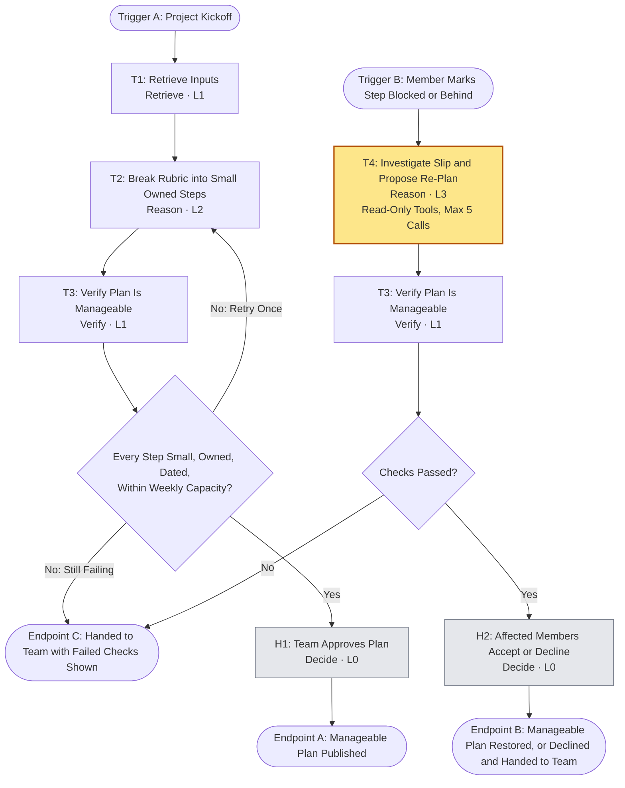

# Workflow of Tasks (DRAFT)

## 1. Workflow Overview

### 1.1 Workflow Goal

Supports the system goal in `README.md`: make a group project manageable by turning the rubric into small, owned, dated steps, and repairing the plan when a step slips.

### 1.2 Unit of Work

Plan one group project and keep it on track until submission.

### 1.3 Triggers

- **A:** Project kickoff (a team member submits the rubric, due date, and team profiles).
- **B:** A member marks a step blocked or behind.

### 1.4 Endpoints

- **A:** Manageable plan approved and published.
- **B:** Manageable plan restored (re-plan accepted), or re-plan declined and handed to the team with the reasoning shown.
- **C:** Checks still failing after the allowed retry; handed to the team with the failed checks shown.

## 2. Tasks, Types, and Levels

| ID | Task | Type | Level | Performed by |
|---|---|---|---|---|
| T1 | Retrieve inputs (rubric, due date, team profiles) from the setup form and database | Retrieve | 1 | Code |
| T2 | Break rubric into small, owned, dated steps | Reason | 2 | Claude (one call, uses the `rubric-to-step-plan` skill) |
| T3 | Verify plan is manageable | Verify | 1 | Code |
| H1 | Team approves plan | Decide | 0 | Team |
| T4 | Investigate slip and propose re-plan | Reason | 3 | Claude with read-only tools |
| H2 | Affected members accept or decline | Decide | 0 | Team |

### T3 manageability checks (code, no model)

1. Every step is 2 hours or less.
2. Every step has an owner and a due date.
3. No member's planned hours in a week exceed their stated availability.
4. Dependencies finish before the steps that need them.
5. The final step lands at least 2 days before the deadline.

## 3. Level 3 Case for T4 (ARC)

| Test | Evidence |
|---|---|
| **A: Action Openness** | A slip can mean the step was too big, blocked on missing information, blocked on another person, or squeezed by a crunch week. The right investigation and fix differ each time, so a sufficient sequence of steps cannot be predefined. |
| **R: Runtime Adaptation** | Each finding changes the next question. If the step was underestimated, check whether the owner's other steps were too, then check who has slack. If it is blocked on a dependency, check what that dependency is waiting on. |
| **C: Containment and Handoff** | Read-only tools, a hard cap of 5 tool calls and 60 seconds, a required structured output. T4 cannot change the plan. Its proposal goes through T3, then H2, where people decide. |

The investigation trace (tool calls, in order, with what each returned) is shown in the UI as evidence.

## 4. Models and Tools

- **Model:** Anthropic model via the Messages API for T2 and T4. Exact model ID to be copied from the Week 6 model workbook and confirmed with the API key before the build.
- **No model** for T1 (parsing) and T3 (deterministic checks).
- **Tools** (direct integration, no MCP):
  - `save_record` / `query_plan`: Supabase (Postgres) writes and reads through the server, using the secret key (server-side only, never in the browser).
  - `check_manageability`: runs the T3 checks.
  - T4 read-only tools: `get_task`, `get_checkin_history` (including free-text notes such as "midterms this week"), `get_member_load`, `get_dependencies`.
- **Stack:** Next.js (React and TypeScript) with API routes; Supabase for shared state.
- **No Canvas integration.** The due date is typed into the setup form.

## 5. Skill Decision

**Include one skill, for T2 only:** `skills/rubric-to-step-plan/SKILL.md`. The inputs change with every project, while the method (size every step, give it an owner and date, keep dependencies in order) and the output format stay stable.

**No skill for T4.** A step-by-step playbook would predefine the investigation path and push the task toward Level 2. T4 gets a goal, boundaries, and an output format in its system prompt only.

## 6. Workflow Diagram

## 7. Demo Plan (4 fictional teammates)

1. Paste a real rubric and due date; add four teammates with free-text skills and preferences. The plan appears as small owned steps; T3 checks pass; the team approves.
2. Switch members to show each person's "next steps" view.
3. Mark Jordan's "Financial model" step blocked. T4 investigates (trace visible), splits the step, moves one piece to a teammate with slack, and defers a nice-to-have. T3 re-checks; affected members accept.
